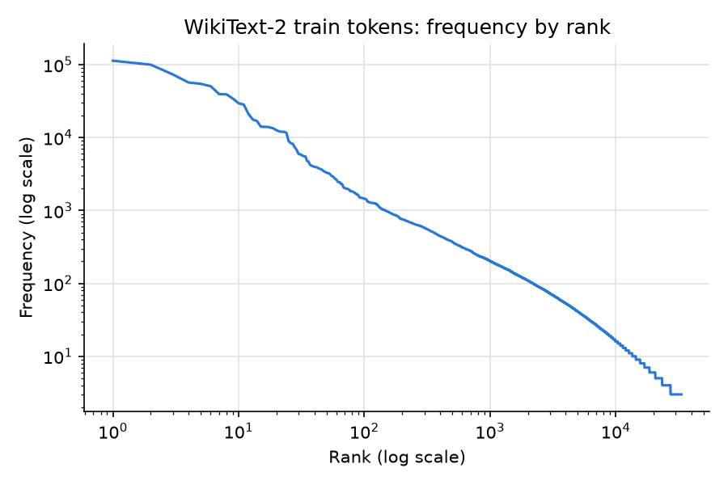

# WikiText-2 statistics

Tokens are the whitespace-separated words in each file; `<eos>` is not counted.

| Split | Lines | Articles | Tokens | Unique tokens | `<unk>` rate | Tokens not in train vocab |
|---|---|---|---|---|---|---|
| train | 36,718 | 600 | 2,051,910 | 33,277 | 2.66% | 0 |
| valid | 3,760 | 60 | 213,886 | 13,776 | 5.48% | 0 |
| test | 4,358 | 60 | 241,211 | 14,142 | 6.31% | 0 |

Train vocabulary: 33,277 distinct tokens.

## Top 20 train tokens

| Rank | Token | Count | Share |
|---|---|---|---|
| 1 | `the` | 113,161 | 5.51% |
| 2 | `,` | 99,913 | 4.87% |
| 3 | `.` | 73,388 | 3.58% |
| 4 | `of` | 56,889 | 2.77% |
| 5 | `<unk>` | 54,625 | 2.66% |
| 6 | `and` | 50,603 | 2.47% |
| 7 | `in` | 39,453 | 1.92% |
| 8 | `to` | 39,190 | 1.91% |
| 9 | `a` | 34,237 | 1.67% |
| 10 | `=` | 29,570 | 1.44% |
| 11 | `"` | 28,309 | 1.38% |
| 12 | `was` | 20,985 | 1.02% |
| 13 | `The` | 17,602 | 0.86% |
| 14 | `@-@` | 16,906 | 0.82% |
| 15 | `that` | 14,135 | 0.69% |
| 16 | `as` | 14,021 | 0.68% |
| 17 | `'s` | 14,002 | 0.68% |
| 18 | `on` | 13,678 | 0.67% |
| 19 | `for` | 13,307 | 0.65% |
| 20 | `with` | 12,606 | 0.61% |

## Rank-frequency plot

